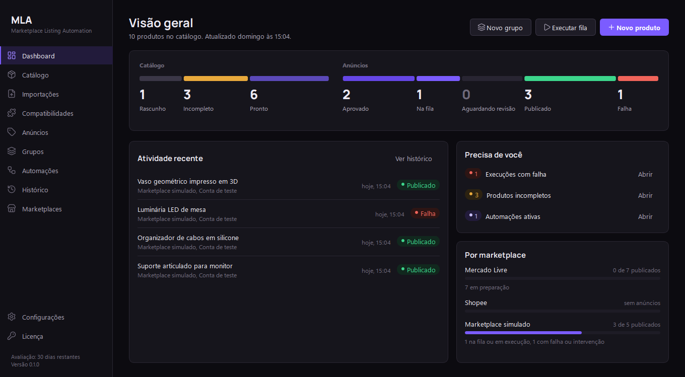
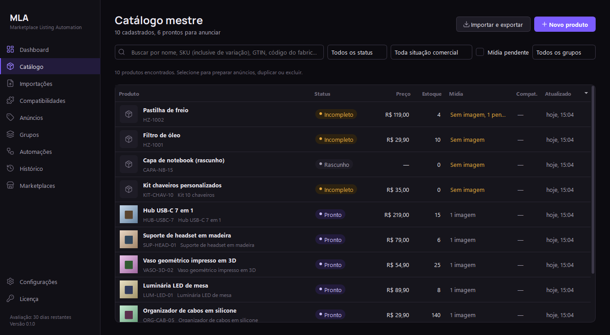
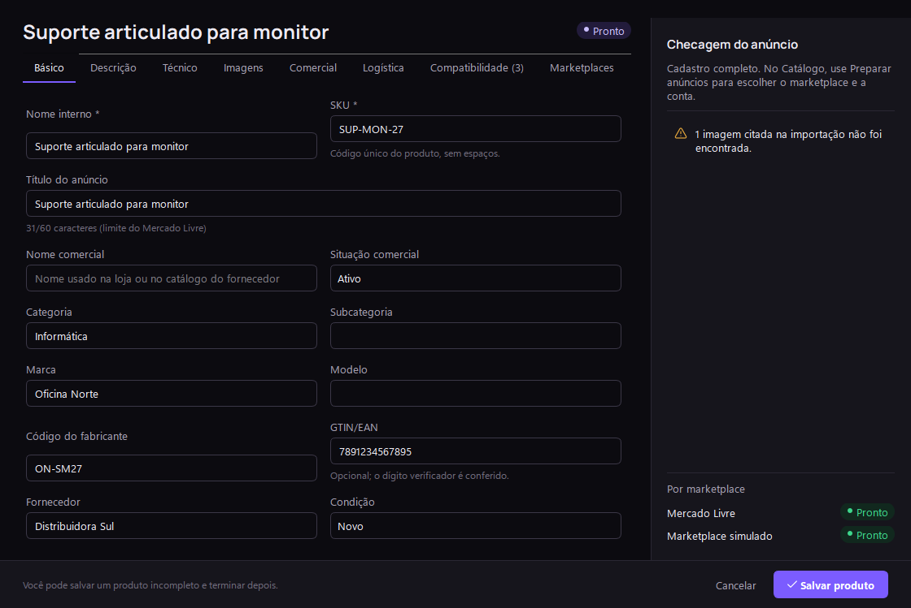
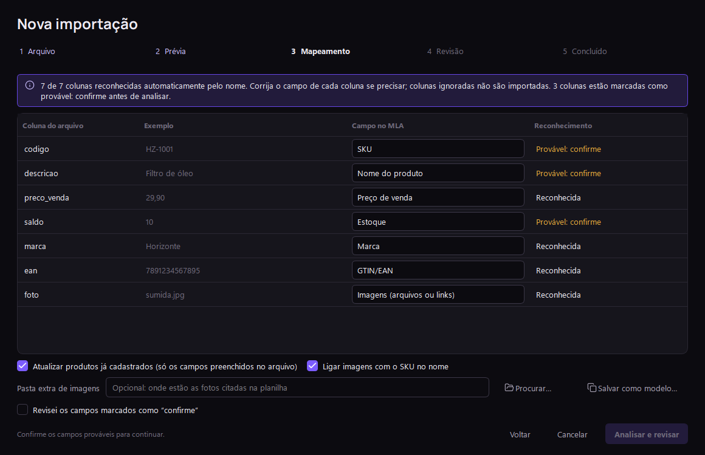
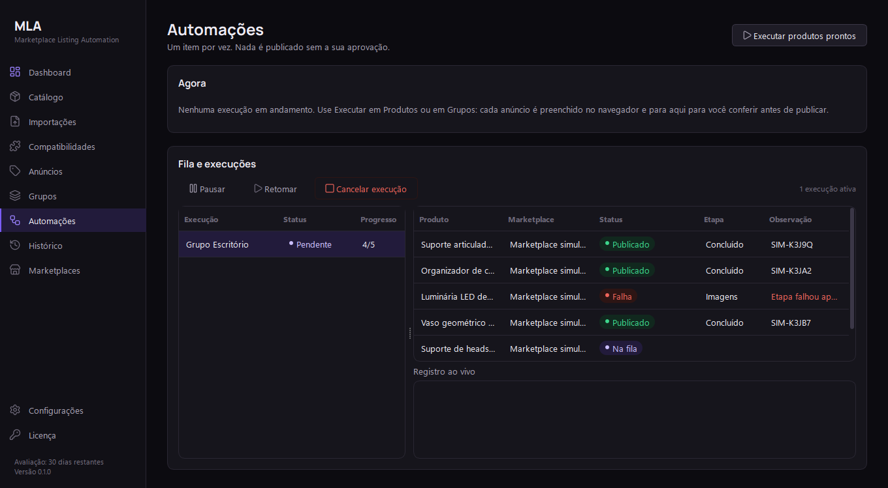
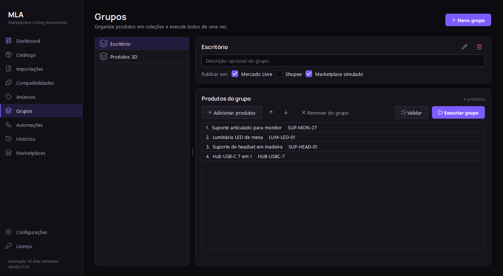

# MLA — Marketplace Listing Automation

**Catálogo mestre, importação de bases e preparação de anúncios em escala para lojistas de marketplace.**
Aplicativo desktop para Windows que transforma a base de produtos da empresa em anúncios revisados por
marketplace e por conta, com automação assistida no navegador e revisão humana antes de qualquer publicação.



> **Status:** v0.1.0 + etapa “Catálogo Mestre Inteligente”. Tudo o que está descrito como disponível abaixo
> funciona e é coberto por testes automatizados. A **publicação real no Mercado Livre e na Shopee ainda está em
> desenvolvimento**: o fluxo completo de publicação hoje roda no marketplace simulado incluído no app.
> As capturas mostram a interface real com dados fictícios de demonstração.

---

## Funcionalidades

### Catálogo mestre inteligente
Um cadastro único do produto físico, separado dos anúncios. Identificação (SKU principal e de variações, código
do fabricante, GTIN/EAN com conferência do dígito verificador, marca, modelo, categoria, fornecedor, nome
comercial), dados comerciais (custo, preço de venda e promocional, estoque e estoque mínimo, unidade, garantia,
condição, situação comercial), dados técnicos (descrição original e técnica, material, cor, peso, dimensões,
especificações, atributos personalizados, referências do fabricante, observações internas) e mídia (imagens com
capa e ordem, variações, arquivos técnicos e mídias pendentes). Nenhum campo novo é obrigatório; um painel mostra
ao vivo o que falta para anunciar.

| Catálogo | Editor do produto |
|---|---|
|  |  |

Busca por nome, SKU (inclusive de variação), GTIN, código do fabricante, marca ou fornecedor; filtros por
situação, mídia pendente e grupo; carregamento incremental para bases grandes; duplicação, exclusão e exportação
em CSV ou JSON (o JSON inclui variações; as imagens são copiadas junto com o arquivo).

### Central de Importações
Importa a base de produtos da empresa em **CSV, XLSX, JSON, XML, PDF (tabela ou ficha técnica) e ZIP** com
planilha e fotos, além de pastas de imagens nomeadas pelo SKU.

| Mapeamento das colunas | Revisão antes de gravar |
|---|---|
|  |  |

- Detecção de formato, codificação e separador; prévia exatamente como o arquivo foi lido.
- Reconhecimento automático de colunas (`codigo`, `preco_venda`, `saldo`, `ean`…); nomes ambíguos exigem
  confirmação; modelos de importação salvos para reutilizar.
- Validação por linha, SKUs duplicados, GTIN em notação científica, variações ligadas ao SKU pai, associação de
  imagens pelo nome ou pelo SKU.
- Cada alteração é mostrada como “valor atual → valor do arquivo”; você decide criar, atualizar ou ignorar.
- Nada é gravado antes da confirmação; a gravação é feita de uma vez (cancelar não altera nada); imagens nunca
  são apagadas; relatório de erros por linha e histórico de importações.
- ZIPs são extraídos com segurança: executáveis, scripts e planilhas com macro são ignorados e nunca executados.

### Compatibilidades
Relaciona cada produto a marcas, modelos, versões, anos, equipamentos e códigos de referência, com a fonte da
informação e o estado de verificação. Dados do cliente entram como confirmados; fabricante e fontes externas
entram como não verificados. O MLA não cria compatibilidades sozinho. Cadastro manual, aba no produto e
importação em massa.


### Preparação de anúncios por marketplace e conta
Um produto mestre gera um anúncio por marketplace e conta, guardando só o que muda (título, descrição, preço,
estoque, categoria, atributos, seleção e ordem de imagens). Estados claros: Rascunho, Incompleto, Pronto para
revisão, Aprovado, Na fila, Em execução, Publicado confirmado, Falha e Requer intervenção. A aprovação é desfeita
automaticamente se o conteúdo mudar, e um anúncio só aparece como publicado com confirmação real.


### Contas de marketplace
Várias contas por marketplace, conta padrão, URL do vendedor validada pelo domínio oficial, navegador Edge
dedicado e isolado para cada conta (nunca o seu perfil pessoal) e teste de conexão com login manual. Abrir uma URL
não é tratado como sessão autenticada.


### Automação com revisão humana
Fila persistente, um item por vez, pausa, retomada e cancelamento, recuperação após fechar o app, prevenção de
anúncios duplicados, capturas de tela e registro de cada etapa. O formulário é preenchido, conferido contra o
cadastro e **só é publicado com a sua aprovação**. Execução individual, em grupo ou em lote.

| Automações | Grupos de produtos |
|---|---|
|  |  |

### Dashboard e histórico
Visão do pipeline do catálogo e dos anúncios, pendências que precisam de você, situação por marketplace,
histórico com filtros, detalhes, reexecução segura e exportação CSV.

### Marketplace simulado
Um marketplace local com login, CAPTCHA de teste, formulário e confirmação, para demonstrar e testar o fluxo
completo sem publicar nada de verdade.

### Pronto para inteligência de mercado e IA (estrutura)
Base já preparada no banco de dados e nos serviços, sem coleta automática, sem IA ativa e ainda sem telas
próprias nesta versão:
- registro de URLs de referência e observações (preço, título, avaliações) sempre com fonte e data;
- contrato para coletores futuros (API oficial primeiro; Scrapling apenas quando os termos da plataforma e a lei
  permitirem), bloqueado até a permissão ser declarada;
- nota de completude do anúncio calculada sem IA;
- sugestões de IA guardadas separadamente dos dados do cliente, aplicadas só se você aceitar, e nunca enviadas a
  serviços externos sem autorização.

---

## Princípios
- **Revisão humana obrigatória**: nada é publicado sem aprovação; publicado só com confirmação do marketplace.
- **Sem atalhos de segurança**: login, CAPTCHA e verificações são sempre feitos pelo usuário.
- **Dados locais**: banco SQLite e imagens ficam no computador (`%LOCALAPPDATA%\MLA`), com backup automático
  antes de cada atualização do banco.
- **Integridade do catálogo**: importações nunca apagam registros nem substituem dados sem mostrar a alteração.
- **Fatos separados de hipóteses**: dados do cliente, informações externas e sugestões de IA ficam separados.

## Ainda não disponível
- Publicação real no **Mercado Livre** e na **Shopee** (depende da inspeção autorizada dos formulários reais);
  já é possível cadastrar as contas, abrir o navegador dedicado e preparar e aprovar os anúncios.
- Coleta automática de dados de concorrentes e agentes de IA (apenas a estrutura existe).
- Extração de imagens embutidas em XLSX, download de imagens por link e leitura de PDF digitalizado (OCR).
- Instalador, cobrança e servidor de licenças.

## Tecnologia
Python 3.13 · PySide6 (Qt) · SQLite (WAL, migrações versionadas) · Playwright com Microsoft Edge ·
openpyxl · pypdf. 178 testes automatizados (unidade, interface e ponta a ponta no Edge com o marketplace simulado).

## Começar
- Usuário: [docs/USER_GUIDE.md](docs/USER_GUIDE.md) e [docs/INSTALLATION.md](docs/INSTALLATION.md).
- Desenvolvimento: [docs/DEVELOPMENT.md](docs/DEVELOPMENT.md), [docs/TESTING.md](docs/TESTING.md),
  [docs/ARCHITECTURE.md](docs/ARCHITECTURE.md), [docs/DECISIONS.md](docs/DECISIONS.md).
- Estado do projeto: [docs/CURRENT_STATUS.md](docs/CURRENT_STATUS.md) e [docs/NEXT_STEPS.md](docs/NEXT_STEPS.md).

```powershell
.venv\Scripts\python -m pip install -e .[dev]
.venv\Scripts\python -m mla          # abre o aplicativo
.venv\Scripts\python -m pytest -m "not browser"   # testes rápidos
```
